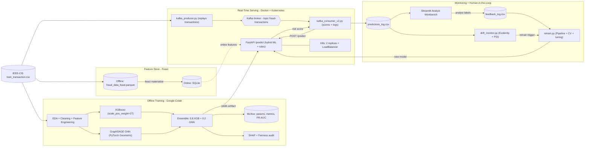

# 🛡️ Real-Time Financial Fraud Detection Platform

End-to-end production ML system: Kafka-streamed transactions are scored by a
hybrid XGBoost + GraphSAGE ensemble served through a Dockerized/Kubernetes
FastAPI microservice, monitored by Evidently AI drift detection (PSI), and
closed by a human-in-the-loop Streamlit analyst workbench with automated
retraining.

## 🏗️ Architecture



## 📊 Key Results (3.5% fraud base rate)

| Model | PR-AUC | ROC-AUC |
|---|---|---|
| Logistic Regression (baseline) | 0.188 | 0.778 |
| Random Forest (baseline) | 0.595 | 0.900 |
| **XGBoost (class-weighted)** | **0.609** | **0.924** |
| GraphSAGE GNN (relational) | 0.496 | — |
| **Blend 0.8·XGB + 0.2·GNN** | **0.615** | — |

Fraud recall: 0.80 · Explainability: SHAP summary plot + card4 subgroup fairness audit.

## 🧰 Tech Stack
XGBoost · PyTorch Geometric · Feast · MLflow · SHAP · Kafka · FastAPI · Docker · Kubernetes · Evidently AI · Streamlit · scikit-learn Pipelines + CV

## 📁 Repository Structure
```
AIML-01-Fraud-Platform/
├── main.py                  # FastAPI microservice (hybrid ML + rules scoring)
├── kafka_producer.py        # Transaction replay producer
├── kafka_consumer_v2.py     # Consumer + prediction logging
├── drift_monitor.py         # Evidently + PSI drift verdict + retrain trigger
├── retrain.py               # Pipeline + Stratified CV + RandomizedSearchCV
├── dashboard_v2.py          # Streamlit analyst workbench (feedback labels)
├── test_feast.py            # Feature Store online-fetch proof
├── k8s/                     # deployment.yaml (2 replicas) + service.yaml
├── fraud_feature_repo/      # Feast repository (SQLite online store)
├── reports/drift_report.html# Evidently visual drift report
├── docs/                    # architecture.png + openapi.json
├── Dockerfile / docker-compose.yml / requirements.txt
└── README.md
```

## 🚀 Quick Start
```bash
docker-compose up -d                 # Kafka + Zookeeper + fraud-api
python kafka_producer.py             # stream 100 transactions
python kafka_consumer_v2.py          # score + log to predictions_log.csv
python -m streamlit run dashboard_v2.py   # analyst workbench :8501
python drift_monitor.py              # PSI drift verdict + retrain trigger
kubectl apply -f k8s/                # optional: K8s orchestration (2 replicas)
```

## 🔌 API Documentation
- Interactive Swagger UI: `http://localhost:8000/docs`
- ReDoc: `http://localhost:8000/redoc`
- OpenAPI spec: [`docs/openapi.json`](docs/openapi.json)

| Endpoint | Method | Purpose |
|---|---|---|
| `/health` | GET | Liveness + model-loaded probe (K8s-ready) |
| `/predict` | POST | Score a transaction → fraud_probability, risk_level, ml_score, rule_score |

Example `POST /predict`:
```json
{"transaction_id": "T1", "amount": 15000.0, "card_type": "visa"}
```
→ `{"fraud_probability": 0.762, "is_fraud": true, "risk_level": "HIGH", ...}`

## 📈 Monitoring & Automated Retraining
`drift_monitor.py` compares live `predictions_log.csv` against the training
reference using **PSI** (banking-industry standard: <0.10 stable, 0.10–0.20
watch, >0.20 drifted) plus an Evidently HTML report. Drift share ≥ 50%
auto-launches `retrain.py` (sklearn Pipeline, 3-fold stratified CV,
RandomizedSearchCV over depth/lr/estimators/weights).

## 🍽️ Feature Store & Explainability
Feast (SQLite online store) guarantees identical features at training and
serving (no training-serving skew). SHAP identifies top drivers
(TransactionAmt, V70, V258); fairness audit reports per-group PR-AUC across
card4 subgroups with small-sample caveats.


## 🎬 Demo Video

A complete 6-minute end-to-end demonstration of the production MLOps pipeline is available here:  
👉 **[Watch the AIML-01 Fraud Detection Demo Video](https://drive.google.com/file/d/1n_mf_pzHygVhOrLPI6IOOZnPpjg6_nhz/view?usp=sharing)**

*(The video covers the full lifecycle:)*
* **Architecture & Codebase:** Walkthrough of the repository structure and the Mermaid architecture diagram.
* **Real-Time Streaming:** Kafka producer streaming live transactions, with FastAPI/Kubernetes pods scoring them in real-time using the hybrid XGBoost + GraphSAGE ensemble.
* **Feature Store:** Proof of Feast online feature retrieval, guaranteeing zero training-serving skew.
* **Automated Monitoring:** Running `drift_monitor.py` to calculate the Population Stability Index (PSI) and viewing the generated Evidently AI HTML drift report.
* **Human-in-the-Loop:** Using the Streamlit Analyst Workbench to review high-risk alerts, submit feedback labels (`CONFIRMED_FRAUD` / `FALSE_POSITIVE`), and close the retraining feedback loop.
* **Kubernetes Self-Healing:** Live demonstration of pod deletion and automatic respawning to guarantee high availability in production.
---
*Bikash Kumar Singh · AI/ML Internship, Nexvia Technologies (NEX-INT-2026-0134)*
