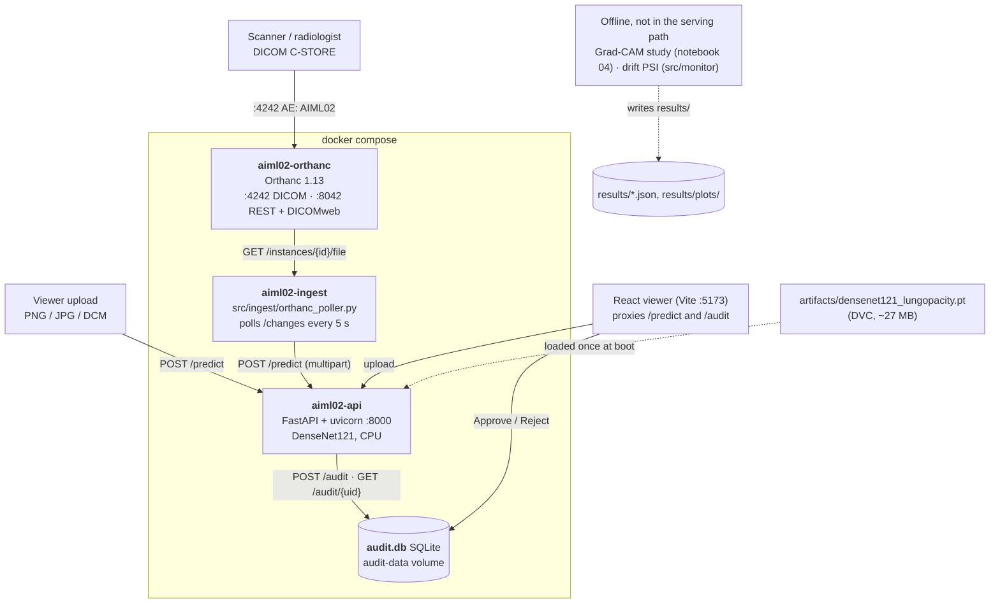

# Architecture

> Portal deliverable: *"Architecture diagram and data or API documentation."*
> Keep the three sections below — system diagram, data flow, API contract.

## 1. System diagram

GitHub renders this Mermaid block; the same topology is three Compose services plus a dev-server front end.



What is deliberately absent: `/predict` returns no heatmap (Grad-CAM is produced offline in notebook 04, so the
viewer's overlay toggle is disabled), there is no message queue between Orthanc and the API (the poller trades
latency for simplicity), and `/audit` has no authentication — see §5.

A second, offline track trains a 3D U-Net (MONAI `DynUNet`) on MSD Task09 spleen CT volumes. It shares the model
artefact store and the Docker build but not the live DICOM path.

## 2. Data flow, step by step

| # | Step | Where | Notes |
|---|---|---|---|
| 1 | Study arrives | Orthanc | Pushed via DICOM C-STORE to AE title `AIML02` on port 4242 |
| 2 | New instance detected | `orthanc_poller.py` | Polls `/changes` every `POLL_INTERVAL_SECONDS`; `StableAge` is **60** (integer seconds — Orthanc 1.13 rejects a boolean value). Orthanc ≥ 1.12 merges child changes into their parent, so a new image usually arrives as a *patient* change and the poller resolves patient → studies → instances |
| 3 | DICOM read | `src/data/dicom_io.py` | `pydicom` reads tags; **windowing** applied before the model sees pixels |
| 4 | Preprocess | `src/data/` | Resize 224×224, ImageNet normalisation |
| 5 | Predict | `src/api/main.py` | DenseNet121 → sigmoid probability |
| 6 | Explain | `src/models/gradcam.py` | Hook on the last dense block, ReLU'd activation map overlaid — offline only; `/predict` returns no `overlay_url` yet, which is why the viewer's toggle is disabled |
| 7 | Review | React viewer | Radiologist approves or rejects, with a free-text reason; nothing is persisted before that |
| 8 | Audit | `audit.db` | `POST /audit` appends one row: `study_uid`, decision, reason, probability, threshold, model version, timestamp. No `pending` rows, no update path |
| 9 | Monitor | `src/monitor/drift.py` | PSI of incoming pixel statistics vs training reference — offline script, not wired into serving |

## 3. API contract

### `POST /predict`

Request: `multipart/form-data`
- `file`: one DICOM instance **or** a PNG/JPG
- `study_uid`: optional string, defaults to the DICOM `SOPInstanceUID`

Response `200`:
```json
{
  "study_uid": "1.2.840.113619.2.55.3...",
  "prediction": "opacity",
  "probability": 0.8685,
  "threshold_used": 0.5107557773590088,
  "model_version": "unversioned",
  "inference_ms": 1232.76,
  "dicom_tags": {"patient_id": "019d950b-…", "modality": "CR", "rows": 1024, "columns": 1024},
  "disclaimer": "For education only. Not for clinical use."
}
```

`study_uid` falls back to the uploaded filename when the file is a PNG/JPG and no `study_uid` form field is given.
There is no `overlay_url`: Grad-CAM is produced offline, not per request.

Errors: `400` unreadable/unsupported image, `422` validation, `503` model not loaded.

### `GET /health`
`{"status": "ok", "model_loaded": true, "device": "cpu", "disclaimer": "…"}` — used by the Docker `HEALTHCHECK`.

### `GET /model-info`
Model name, version, task, **label semantics**, split policy, disclaimer.

### `POST /audit`
`{"study_uid": "…", "decision": "approved" | "rejected", "reason": "…", "probability": 0.86, "threshold_used": 0.51, "model_version": "…"}`
→ `201` with the inserted row. The decision pattern is enforced by pydantic, so `"maybe"` is a `422`.
**No authentication** — this is the main gap between the demo and a real audit trail.

### `GET /audit/{study_uid}`
Every decision recorded for that study, oldest first.

## 4. Design decisions and their trade-offs

| Decision | Why | What it cost |
|---|---|---|
| Split on the image, never the CSV row | `stage_2_train_labels.csv` has one row per **bounding box**: 30,227 rows describe 26,684 pictures. Shuffling rows leaked 16.8 % of test images into training (measured in notebook 01). `src/data/splits.py` groups on `patient_id`, which also covers the multi-film case real archives have | The group is one image here, so it buys nothing measurable in this release — the code is written for the general case |
| Binary opacity-vs-not, not 14 findings | One clean question, measurable; multi-label on a small subset is unreliable | Ignores the richer label space, and 57 % of negatives are "abnormal for another reason" |
| Grad-CAM instead of SHAP | SHAP over 224×224 pixels is computationally impractical; an activation map is what a radiologist can read | Not a Shapley-value guarantee — do not call it one |
| SQLite for the audit log | Single-node demo, zero ops | No row-level security, no concurrent writers |
| Google Drive as DVC remote | Local disk is ~22 GB free; the dataset is ~3.4 GB extracted plus Track B's ~2.3 GB | Slow first pull; a real deployment wants S3/GCS. Works only with a **personal Desktop-app OAuth client** — `dvc-gdrive`'s shared client is refused the `drive` scope — and only for the single archive object, since the image folder would be 26,688 separate uploads. Colab cannot run that interactive consent flow, so training data moves by direct Drive upload instead of `dvc pull`. Setup details in `README.md` |
| Orthanc polls rather than pushes | Simpler to reason about and to record a demo against | Adds up to `POLL_INTERVAL_SECONDS` latency |

## 5. Security and privacy notes

- The audit row stores the study UID, the probability and threshold that produced the decision, the model version and
  a free-text reason — no patient name. The reason is typed by a human, so it is not de-identified by construction.
- **Nothing is authenticated.** Orthanc runs with `AuthenticationEnabled: false`, `/audit` accepts unauthenticated
  writes, and `audit.db` is a plain SQLite file inside a Docker volume: anyone with the file can edit the table, so the
  log is not tamper-evident. In a real deployment: enable authentication, bind ports to localhost or an internal
  network, put TLS in front, and hash-chain or sign each audit row.
- `kaggle.json` and any Orthanc credentials are git-ignored. Never commit them.
- No PHI is committed to this repository. RSNA data is de-identified at source.
